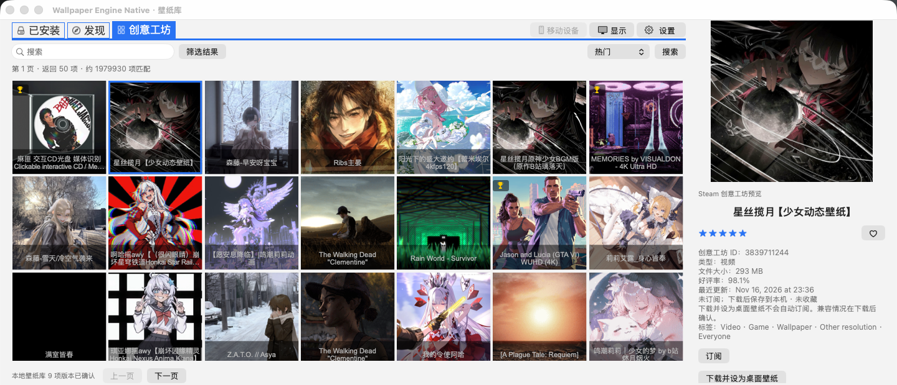

# Wallpaper Engine Native

macOS 上直接播 Wallpaper Engine 壁纸的客户端，Swift + Metal 写的原生程序。不跑 Wine、不做 Web 套壳，启动后读本机 Steam 里已经装好的内容。


## 能做什么

- 播 Scene、Web、Video 三类壁纸，桌面后面单开一层窗口用 Metal 渲染。
- 接本机 Steam 和创意工坊：浏览、搜索、订阅、下载、投票、收藏，账号和下载队列都走 Steam 自己那套。
- 多显示器各设各的壁纸，拔掉再插回来还是原来那张。
- 壁纸库、项目详情、内置编辑器、播放列表、桌面快捷键。


## 创意工坊

上面这张是已安装的库，下面是创意工坊页。列表、详情、订阅和「下载并设为桌面壁纸」都在同一个窗口里，走 Steam 客户端自己的登录态，所以不用在这个程序里再登一次。



## 0.216.1 修的两个问题

**Steam 连不上创意工坊。** Steam 客户端 11 月 13 日更新后，`libsteam_api.dylib` 把 `SteamUser` 接口从 v023 换成了 v024，旧的导出符号被删掉。代码里原来写死 `SteamAPI_SteamUser_v023`，`dlsym` 直接失败，订阅同步、浏览、下载、投票、收藏就一起挂了。现在改成列出这份 dylib 里实际导出的版本号，从新往旧试，`SteamUGC`、`SteamUtils`、`SteamApps` 同样处理。Steam 下次再升级也不用改代码。

**选了壁纸不生效。** 0.215 加了逐显示器分配以后，在主库里手动点一张壁纸只更新了 `lastProject`，屏幕上那份分配还留着，桌面就继续播旧的。现在手动选默认壁纸时会把已连接屏幕的分配一并清掉，布局和画面在同一个提交里写下去；已经拔掉的显示器条目保留，插回来还认原来的壁纸。

## 已知问题

- 只编了 Apple Silicon，系统要 macOS 14 起。Intel 机器没试过。
- 复杂 Scene 的脚本、粒子、特效和自定义着色器只覆盖了一部分，缺的会降级或者干脆不显示。
- 多屏热插拔、睡眠唤醒、跨 Space 切换没在所有机型上验证过。
- 构建是 ad-hoc 签名，没有 Developer ID，也没做公证。Gatekeeper 会拦，第一次打开得右键「打开」，或者 `xattr -d com.apple.quarantine` 一下。

## 从源码构建

要 Apple Silicon、macOS 14+、Xcode Command Line Tools 和 Python 3。

先验一下仓库自带的演示素材：

```sh
python3 tools/bundled_wallpapers.py --verify
```

再编：

```sh
./native/build.sh --output "$PWD/out/Wallpaper Engine Native.app"
```

产物会自动做 ad-hoc 签名。构建过程不联网，不下载 Steam、Wallpaper Engine 或者任何工坊内容。

## 许可

项目自己的代码走 MIT，见 [LICENSE](LICENSE)。仓库里的三张 Starter Wallpaper 是项目自己做的演示素材。Wallpaper Engine 和 Steam 的名字、图标归 Valve，这个项目跟 Valve 没有关系。工坊里的壁纸归各自的作者，用之前看一眼作者的授权。

提 issue 的时候带上 macOS 版本、芯片型号、壁纸类型和能公开的最小复现步骤。别贴工坊文件、Steam 凭据或者个人目录。
