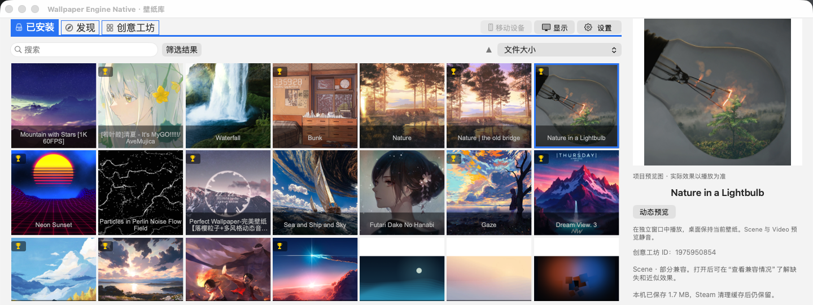

# Wallpaper Engine Native

macOS 上播 Wallpaper Engine 壁纸的客户端。Swift + Metal 写的原生程序，不跑 Wine，不做 Web 套壳，读本机 Steam 里已经装好的东西。


## 装上

Releases 里下 arm64 的 dmg，拖进「应用程序」，右键点图标选「打开」。没做公证，Gatekeeper 只拦这一次。

```sh
xattr -d com.apple.quarantine "/Applications/Wallpaper Engine Native.app"
```

Apple Silicon，macOS 14 起。用之前得有正版 Wallpaper Engine，这程序不提供绕过 Steam 的下载办法。

## 跑到什么程度

| | 状态 |
|---|---|
| 芯片 | Apple Silicon（M1 及以上）。Intel 跑不了 |
| 系统 | macOS 14 起 |
| Scene 壁纸 | 能播。脚本、粒子、模型、光照、后处理覆盖一部分，缺的降级或者不显示 |
| Web / Video 壁纸 | 能播 |
| 创意工坊 | 浏览、搜索、订阅、下载、投票、收藏，走本机 Steam 的登录态 |
| 多显示器 | 每屏各设各的，拔掉插回来还是原来那张 |




## 几个数字

M4 / macOS 26 上播工坊里一张 3D 场景壁纸（1308734162）：

```
CPU        0.1%       主线程大部分时间在等
GPU        54%        像素在 GPU 上算
进程镜像    1080 个    系统 1079，自己 1，第三方 dylib 0 个
app       17 MB      主二进制 14 MB，没有跨平台运行时
```

去掉模拟层之后就是这个样子。屏幕上的画面 GPU 直接出，中间没有指令翻译。

## 它是怎么做到的

壁纸文件是数据。`scene.pkg` 是个容器，里面装压缩过的像素、作者的 JSON 和 GLSL 源码，从头到尾没有一行可执行代码。这个项目干的事是写一个能读这个容器的程序，把这些数据解释成画面。

容器格式官方没公开过。逆向工具只能告诉你某个字段怎么参与投影、混合模式哪个值对应什么公式，容器本身的结构得拿真实壁纸对。所以装不上的壁纸最后都会变成一条明确的报错，写着版本对不上还是资源坏了，而不是黑屏或者闪退。

真正逼着必须原生重写的是窗口。桌面图标下面那一层只接受自己的 NSWindow，虚拟机里的窗口进不去。CrossOver 当初把官方程序跑出了画面，画面却只能待在自己的容器里，桌面还是原来那张。

带自定义着色器的壁纸也能放。作者在壁纸里带的那套着色器方言，程序自己认，交给 GPU 编，所以水面波纹、镜头晃动、飘落的花瓣这类效果能正常出来，不需要作者配合，也不用改壁纸文件。个别效果和 Windows 上不完全逐像素一致，但不缺层、不黑块。粒子、泛光、阴影、体积光、反射按层叠起来，最后合成到桌面那一层。

## 更新记录

**0.217.1** 用 `PKGV0024` 打包的 Scene 能放了。这类壁纸之前整张被拒，现在能完整加载，比如 3832644652，102 个资源全在，星空、云层、前景草叶都正常。碰到确实不认识的包版本，报错会列出目前支持的版本，一眼能看出是版本号旧了还是文件本身坏了。

**0.217.0** 硬盘能腾出来了。工坊下载的壁纸会在本机留副本，退订之后不会自己消失，时间一长就是几个 G。现在状态栏菜单里点「清理未订阅的壁纸副本…」，它先核对显示器分配、配置、播放列表、应用规则还有没有在用，把能删的列出来等你点头，Steam 没回应就一份不动。这边实测 18 份副本占 1.4 GB，其中 10 项早没人用，一次能腾出 102.8 MB。

**0.216.1** Steam 升级之后创意工坊照常能用。11 月 13 日 Steam 客户端更新换掉了底层接口版本，之前订阅同步、浏览、下载、投票、收藏会一起失灵，装上这版就恢复，以后再遇到 Steam 改版也不用等新版本。同一版还修了换壁纸不生效：手动点一张，桌面立刻换，不用重启程序。

## 已知问题

- 复杂 Scene 的脚本、粒子、特效、自定义着色器覆盖一部分，缺的降级或者不显示。
- 多屏热插拔、睡眠唤醒、跨 Space 切换没在所有机型上验证过。
- ad-hoc 签名，没有 Developer ID，没公证。
- 依赖 Steam 客户端的私有接口，它改一次版本这边要跟一次。已经改成探测式，离零维护还有距离。

## 自己编、跑测试

要 Apple Silicon、macOS 14+、Xcode Command Line Tools 和 Python 3。命令都在仓库根目录：

```sh
python3 tools/bundled_wallpapers.py --verify
./native/build.sh --output "$PWD/out/Wallpaper Engine Native.app"
```

产物自动 ad-hoc 签名。构建不联网，不下载 Steam、Wallpaper Engine 或任何工坊内容。

`synchronizer/Tests/` 里四套检查，每套自己编一个假的 `libsteam_api.dylib` 再跑，不碰真 Steam、不用登录、不写用户目录：

```sh
zsh .github/run_native_checks.sh
```

订阅 23 项、收藏 34 项、投票 79 项、副本回收 24 项，合计 160。每套会校验输出里 `passed` 等于 `checks`，并确认 `realSteamAccountUsed` 和 `userSteamDataWritten` 都是 false。push 和 PR 会在 arm64 runner 上跑这四套，再全量编一次。

查 Steam 接口版本漂没漂，`tools/steam_native_connection.swift` 直接读本机那份 dylib 打印账号、订阅和下载状态，只读不写：

```sh
xcrun swift tools/steam_native_connection.swift
```

清理副本的命令行版本在 `tools/reclaim_saved_workshop.swift`，默认试运行：

```sh
xcrun swiftc -O native/Sources/WallpaperEngineNativeHost/SavedWorkshopReclaim.swift \
             tools/reclaim_saved_workshop.swift -o /tmp/we-reclaim
/tmp/we-reclaim --helper synchronizer/build/we-workshop            # 只看会删什么
/tmp/we-reclaim --helper synchronizer/build/we-workshop --apply    # 真删
```

## 想找人搭把手

最想要的是愿意试一张壁纸、然后把卡住的地方写清楚的人：哪张壁纸、什么芯片、哪一步、屏幕上什么样。这活儿听着没技术含量，其实最省事也最有用。

会 Metal 和 AppKit 的也缺，渲染侧还有一批降级路径可以补。手里留着 Intel Mac 的同样缺，帮着确认确实跑不了也算进度。

开 issue，标题写试过的东西加结论，带上 macOS 版本、芯片型号、壁纸类型和最小复现步骤。工坊文件、Steam 凭据、个人目录别贴。

## 底线

程序里没有 Wallpaper Engine 的官方素材，不打包壁纸，不提供绕过 Steam 下载的办法。用户买正版，用自己的账号订阅，工坊壁纸归各自作者。Wallpaper Engine 和 Steam 的名字、图标归 Valve，这项目跟 Valve 没关系。

代码走 MIT，见 [LICENSE](LICENSE)。仓库里那三张 Starter Wallpaper 是自己做的演示素材。
